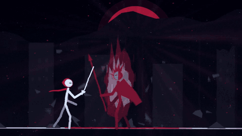

# Stickfight

**Write a stick-figure fight in a Python file, and it renders as a music video locked to your song's beat.**



Full sample with sound: [media/sample_duel.mp4](media/sample_duel.mp4)

Stickfight is a small procedural animation engine. You describe the story in beats (who stands where, who
attacks, where the camera cuts), and it renders every frame from code: inked stick figures, sword trails,
hit-stop, slow motion, sparks, dust, shockwaves, power-up auras, rain, mist and god rays. A beat finder reads
your song, so every cut and every hit lands on the music.

No 3D models, no motion capture, no AI image models. Just Python, numpy and skia.

## Install

You need Python 3.10 or newer and [ffmpeg](https://ffmpeg.org/download.html) on your PATH. `master.sh` and
`mix_sfx.sh` are bash scripts: on Windows run them from Git Bash or WSL.

```bash
git clone https://github.com/arcofcreations-collab/stickfight.git
cd stickfight
python -m venv .venv
# Windows: .venv\Scripts\activate      macOS/Linux: source .venv/bin/activate
pip install -r requirements.txt
```

## 60-second quickstart

```bash
# 1. make the self-made sample track and a starter set of synthetic sound effects (no downloads)
python tools/make_sample_audio.py

# 2. render the sample story at 720p with the track (about 1 to 3 minutes on a laptop)
python render.py stories/sample_duel.py --w 1280 --h 720 --sub 1 --workers 4 --audio samples/sample_track.wav --out sample.mp4

# 3. add the sound effects and master to -14 LUFS (bash)
python sfx.py stories/sample_duel.py sfx.wav
bash mix_sfx.sh sample.mp4 sfx.wav sample_final.mp4 -9
```

Want a quick look first? Render three stills and a contact sheet:

```bash
python render.py stories/sample_duel.py --sub 1 --stills 5,26,39 --stills-dir work/stills
python contact.py work/stills sheet.png
```

## Make your own video

1. **Map the song.** `python beatmap.py song.mp3 stories/song.beatmap.json` writes the beat grid, downbeats and
   per-bar energy. `python beatmap.py song.mp3 x --survey` prints a one-line energy profile so you can see the
   intro, build and drop.
2. **Write the story.** Copy `stories/sample_duel.py`, point `BEATMAP` at your json, and write shots and moves in
   beats.
3. **Check stills**, then render: `python render.py stories/x.py --out film.mp4 --audio song.mp3 --workers 6 --sub 2`.
4. **Vertical Short:** `python render.py stories/x.py --vertical --from 24 --to 54 --out short.mp4 --audio song.mp3`.
   It reframes for 9:16 instead of cropping.
5. **Sound:** `python sfx.py stories/x.py sfx.wav`, then `bash mix_sfx.sh film.mp4 sfx.wav final.mp4 -9`.
6. **QA:** `python qa_cuts_story.py stories/x.py final.mp4` checks every cut sits on its beat.

A story file is a `build(fps, W, H, vertical)` function that returns a `Story`:

```python
st = Story(BEATMAP, fps, W, H)
hero = st.actor("ren", kind="hero", weapon=dict(len=110, kind="katana"), scarf="red")
boss = st.actor("mask", kind="villain", look="rival", weapon=dict(len=150, kind="spear"))
duel(st, hero, boss, 49, "abab cLpb dD.k", 600)           # a beat-locked exchange, one token per beat
st.slowmo(78, w=1.0, r=0.2)                               # ramp into slow motion; the hit stays on beat 78
st.shot(48, 52, "road", dict(follow=["ren", "mask"], zoom=1.5, orbit=10), palette="night")
```

## How it works

| file | what it does |
|---|---|
| `beatmap.py` | a fast numpy-only beat finder: fixed beat grid, downbeats, per-bar energy and a novelty curve for sections |
| `rig.py` | the skeleton: forward kinematics, about 75 poses, run, walk and wall-run cycles, easing and keyframe tracks |
| `engine.py` | the story model (actors, shots, environments, FX events) and the skia renderer |
| `choreo.py` | choreography generators: `duel()` turns a pattern string into a beat-locked exchange, plus `kill()`, `civ()` and `power_up()` |
| `hyper.py` | the big moments: flame aura, afterimages, floating rocks, bursts, beam clashes, thrown swords |
| `ambience.py` | per-frame atmosphere: colour grade, god rays, mist, heat shimmer, vignette and grain, ash, birds, flags, crowds |
| `render.py` | parallel renderer: worker processes, x264 segments, concat, mux audio; `--vertical`, `--from/--to`, `--stills`, `--sub` motion blur |
| `sfx.py` | builds a sound-effects stem from the story's cues, from your own sound library |
| `mix_sfx.sh`, `master.sh` | lay the stem under the song and master to -14 LUFS with a peak limiter |
| `contact.py`, `qa_cuts.py`, `qa_cuts_story.py` | contact sheets and beat-sync checks |

Every frame is a pure function of time, so any frame renders on its own and workers split the film freely.
Shots and moves are written in beats. Slow motion and hit-stop warp "action time" against "song time", and
sounds are placed through the same warp, so a hit is seen and heard on its beat.

### duel() tokens

One token per `step` beats (some take more): `.` guard, `-` hold, `a/b` attack blocked, `A/B` attack lands,
`k/K` kick, `x/X` launch, `d/D` dodge with afterimages, `c` blade clash, `L` blade lock (2 steps), `p/P` parry
and riposte, `g/G` grab and throw (2 steps; the fighters swap sides), `s/S` spinning back kick, `r` blur-speed
strike trade, `f/F` sword toss, kick, catch and cut (2 steps), `z/Z` disarm and re-catch (2 steps), `j/J`
launch, air juggle and ground bounce (3 steps). Lowercase means the first fighter acts and uppercase means the
second, except `a/A` and `b/B`, where the letter says who attacks and the case says whether it lands.

### What else the engine can do

- **Camera:** follow actors or a fixed point, push-ins, rotation, orbit, low angles, head close-ups, whip pans
  with streak blur, shake and zoom punches.
- **Shot extras:** letterbox, slow-motion tags, out-of-focus foreground layers (over-the-shoulder, rack focus),
  split-screen face-offs, manga freeze-frame cut-ins and flashbacks.
- **Places:** towers you can cut, breakable walls and gates, a town with houses and lanterns, a canyon with a
  rope bridge that can be cut, hills, stars, rain, ash, embers, mist, heat, god rays, sun or moon.
- **People:** hero, ally, villain, minions, townsfolk and children; hoods, masks that crack, helmets; katana,
  greatsword, twin daggers, spear and hammer; scarves, glowing eyes, power-up auras, growing transformations.
- **Game-feel knob:** `st.hitstop_scale` (or `STICKFIGHT_HITSTOP=0.5` with the sample stories) shortens or
  stretches every hit-stop. `stories/feel_test.py` is a locked-off fight made for measuring this with
  [Feel Gap](https://github.com/arcofcreations-collab/feel-gap).

## Sound

No sound effects or songs ship with this repo. `tools/make_sample_audio.py` writes a self-made 120 bpm sample
track and a small synthetic starter set so everything runs; for real videos, use your own song and recordings.

`sfx.py` looks for files in `sfx_library/<kind>/` (or the folder in `STICKFIGHT_SFX_LIB`, or `--lib`):

```
sfx_library/
  whoosh/  hit/  punch/  clash/  clash_big/  thud/  boom/  scrape/  draw/  dodge/
  rumble/  power/  roar/  crackle/  bell/  screams/  swoosh_big/
  ambience/wind/  ambience/storm/  ambience/bells/  ambience/night/  ambience/darkwind/  ambience/rumble/
```

Drop any .wav, .ogg, .flac or .mp3 files into those folders; it picks one per cue. Missing kinds are skipped.
`python sfx.py --check` lists what it found. Free libraries that allow use in your videos include
[Kenney's CC0 packs](https://kenney.nl/assets/category:Audio) and the yearly
[Sonniss GDC bundle](https://sonniss.com/gameaudiogdc). Read each licence: most allow use in your work but not
re-sharing the raw files, which is why none are in this repo.

## Limits

- Rendering is CPU only. A 1080p, 3-minute video with motion blur (`--sub 2`) takes a while; use `--workers`
  and render stills while you write. Each worker uses about 1 to 2 GB of RAM.
- This skia build is slow at blending large translucent areas, so big gradients and blurs are done in numpy.
  Keep huge translucent shapes rare.
- The beat finder assumes a steady tempo (most produced songs). Songs with tempo changes need a hand-made grid.
- Fonts: the title text uses Impact and Palatino Bold on Windows, and falls back to other system fonts or
  skia's default elsewhere. Set `STICKFIGHT_FONT_TITLE` / `STICKFIGHT_FONT_SERIF` to any .ttf to choose.
- Stories are code. There is no GUI timeline.

## Tests

```bash
python tests/test_smoke.py
```

Loads every shipped story, renders a few small frames (16:9 and 9:16), and builds a sound-cue stem. No ffmpeg
needed for the test. Also runs under `pytest`.

## Licence and credit

MIT, see [LICENSE](LICENSE). The sample story, sample track and starter sounds are original and MIT too.

Made by Journeyman AI. We make AI fights, living worlds and stick-figure music videos on YouTube:
[youtube.com/@JourneymandigitalAI](https://www.youtube.com/@JourneymandigitalAI).
